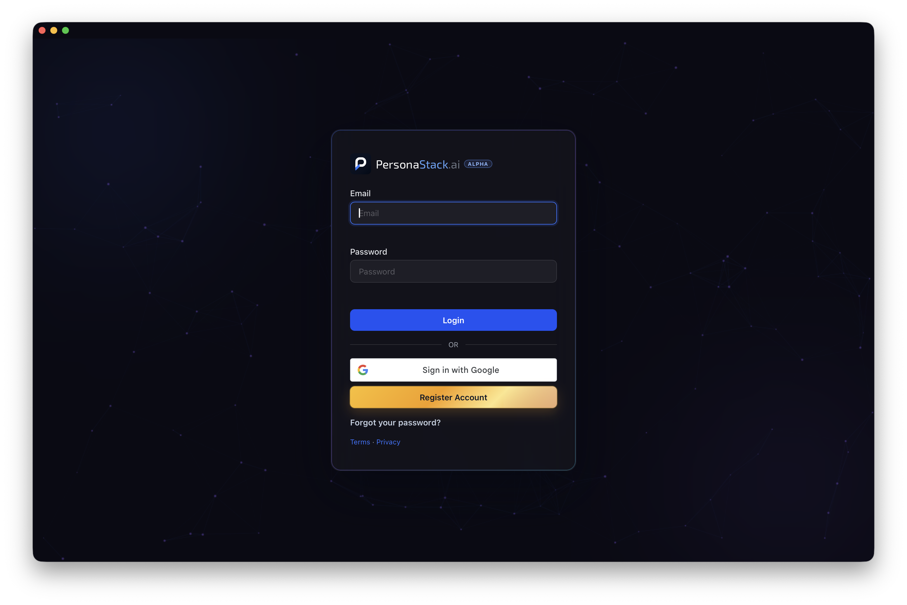

<div align="center">


<h1>PersonaStack for macOS</h1>

<p>Your PersonaStack workspace in a native macOS app.</p>

<p>
<a href="https://github.com/personastack/homebrew-tap"></a>

</p>

<p><a href="https://personastack.ai">Website</a> · <a href="https://github.com/personastack/macos/releases/latest">Latest download</a></p>



</div>

## Install with Homebrew

Copy and paste this command into Terminal:

```sh
brew install --cask personastack/tap/personastack
```

Open PersonaStack from Applications and sign in. Requires macOS 14 or later.

The build uses the pinned Developer ID Application certificate for PersonaStack, LLC (team `5T2T8KL852`). The app and Sparkle helpers use hardened runtime and secure timestamps. Release builds are notarized by Apple. Both the app and installer carry stapled notarization tickets.

## Desktop Control with CUA

Choose **Desktop Control → Set Up CUA…** in PersonaStack. The window shows the next button: **Install CUA**, **Start CUA**, or **Grant CUA Permissions**. A compatible installation is reused. Allow CUA in the macOS prompts or System Settings. The window checks readiness before showing **Done** or **Connect PersonaStack**.

Failures stay visible with a recovery action. A startup or permission failure keeps the installed app. Use **Retry Start**, **Grant CUA Permissions**, or **Check Again** as shown. CUA runs as a service, so opening its app does not guarantee a settings window. Repairing CUA does not replace your Desktop Control integration or resume paused control. If linking fails after CUA is ready, choose **Return to Connection** and use **Check Again** in Desktop Control.

CUA controls this Mac. PersonaStack connects your authorized agents to CUA. CUA has its own login service and remains installed after PersonaStack is removed. Cloud control through PersonaStack still requires PersonaStack to run. The menu shows CUA readiness separately from the cloud connection.

PersonaStack no longer asks for desktop Accessibility, Screen Recording, Full Disk Access, or browser Automation permissions. Chat microphone and notification permissions remain separate. CUA must receive its own grants. Old PersonaStack grants are not transferred or reset automatically.

Desktop Control includes same-account CLI execution with pipe or interactive PTY input and output through the PersonaStack relay. CLI and GUI tools share the existing assignment and control lease. CUA owns GUI capabilities and local GUI policy. Dedicated filesystem tools and PersonaStack's locked-screen helper remain retired. Running a service does not guarantee locked-screen or closed-lid GUI control.

## Updates

PersonaStack checks for updates while it is running. Open the menu-bar dropdown or the **PersonaStack** menu and choose **Check for Updates…** to check now. You can opt into background downloads in the menu-bar dropdown. Prepared updates install when you quit PersonaStack. The app does not restart without your action.

## Publish a release

Keep the authored user changes in `release-notes/next.md`. Commit code and notes to `main`, then create a new stable `vX.Y.Z` release at [GitHub Releases](https://github.com/personastack/macos/releases/new) targeting `main`. A tag push also starts the same workflow:

```sh
git tag -a v0.11.0 -m "PersonaStack 0.11.0"
git push origin refs/tags/v0.11.0
```

The release workflow runs tests and universal builds, signs and notarizes the installer, then automatically publishes the source Release, Homebrew cask and signed Sparkle feed. Actions fills the changelog version and date from the tag/run. It verifies the served public installer bytes and retains a delivery receipt. There is no local packaging or manual publication approval step. `workflow_dispatch` remains an optional unsigned development check.

All ten custom secrets are repository secrets in `personastack/macos`. The public updater key is a repository variable. Their exact-name recovery fields are in the PersonaStack 1Password vault item **PersonaStack macOS Release - ACTIVE GitHub Actions Recovery** (`yggfet2yylb3jaxqnfy6krswle`). Original signing archives and the Communication Notifications profile are also retained there as separate documents.

Configure these repository settings once before the first tag. Renew expiring Apple credentials and provisioning profiles as needed:

- Variable `PERSONASTACK_SPARKLE_PUBLIC_ED_KEY` and secret `PERSONASTACK_SPARKLE_PRIVATE_ED_KEY`.
- Secret `HOMEBREW_TAP_TOKEN` with write access to `personastack/homebrew-tap`.
- Secrets `PERSONASTACK_DEVELOPER_ID_P12_BASE64` and `PERSONASTACK_DEVELOPER_ID_PASSWORD` for the pinned Application identity.
- Secrets `PERSONASTACK_DEVELOPER_ID_INSTALLER_P12_BASE64` and `PERSONASTACK_DEVELOPER_ID_INSTALLER_PASSWORD` for the Installer identity.
- Secrets `PERSONASTACK_NOTARY_KEY_P8_BASE64`, `PERSONASTACK_NOTARY_KEY_ID` and `PERSONASTACK_NOTARY_ISSUER_ID`.
- Secret `PERSONASTACK_COMMUNICATION_PROFILE_BASE64` containing the base64-encoded Apple Developer ID provisioning profile for `ai.personastack.desktop`, team `5T2T8KL852`, the pinned Application certificate and Communication Notifications capability.

## Installer packaging

The main package installs PersonaStack.app only. `scripts/package-desktop-installer.sh APP OUTPUT_PKG` builds it without installing it. For unsigned local validation, set `PERSONASTACK_SIGN_INSTALLER=0`. Release packaging retains Developer ID signing, notarization, and Sparkle verification.

New packages do not install the old locked-control plugin. During upgrade, the package verifies the existing removal utility against the pinned signing certificate and runs its guarded policy restoration before removing the retired plugin and utility. A missing utility, invalid signature, or policy conflict stops the upgrade without deleting the legacy payload. Fresh installs skip this step. Homebrew uninstall also guards legacy cleanup and never removes standalone CUA.
